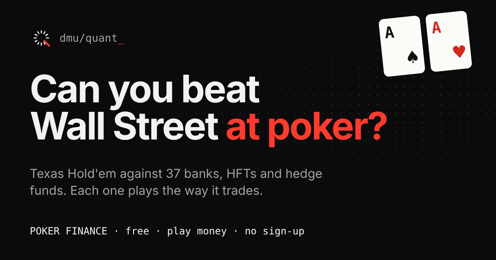

<div align="center">


# Poker Finance

**Can you beat Wall Street at poker?**

Texas Hold'em against 37 banks, HFTs and hedge funds. Every bot plays poker the way its firm trades, and desk notes explain the finance behind each move.

A DMU Quant Society project · De Montfort University, Leicester

[Play now](https://dmu-poker-finance.vercel.app) · [How the bots think](docs/bot-strategies.md) · [Roadmap](docs/roadmap.md) · [Contribute](CONTRIBUTING.md)



</div>

---

## What it is

Poker Finance is a free browser game for the general public. You sit at a six-seat No-Limit Texas Hold'em table against five firm bots:

| Trading style       | How it plays poker                                                               | Firms                                                                                          |
| ------------------- | -------------------------------------------------------------------------------- | ---------------------------------------------------------------------------------------------- |
| Market maker / HFT  | Plays lots of hands with small bets, backs off under pressure (inventory limits) | Citadel Securities, Jane Street, Optiver, IMC, SIG, Virtu, Flow Traders, HRT, Jump, Tower, XTX |
| Quant / stat-arb    | Pure expected value, Kelly-style sizing, learns your habits                      | Renaissance, Two Sigma, D. E. Shaw, AQR, QRT                                                   |
| Global macro        | Few hands, big conviction bets                                                   | Bridgewater, Brevan Howard, Tudor, Rokos                                                       |
| Multi-strategy pods | Solid until a 25% drawdown, then tightens hard                                   | Millennium, Citadel, Point72, Balyasny, ExodusPoint                                            |
| Trend follower      | Bigger after wins, smaller after losses                                          | Man AHL, Winton, Aspect, Lynx                                                                  |
| Investment bank     | Rarely bluffs, capped risk per hand (capital rules)                              | Goldman Sachs, JPMorgan, Morgan Stanley, Barclays, HSBC, Deutsche Bank, UBS, BNP Paribas       |

Play money only. No sign-up, no ads, no prizes. Anonymous visit counts come from Vercel Web Analytics; Google Analytics runs only for visitors who accept it. See the [privacy notice](docs/privacy.md).

> **Disclaimer.** Firm names describe publicly reported trading styles. The bots are caricatures, not any firm's real strategy. No firm is affiliated with or endorses this game. See [DISCLAIMER.md](DISCLAIMER.md). One config switch replaces every real name with a fictional alias.

## Features (v0.1)

- Full No-Limit Hold'em engine: blinds, min-raise rules, short all-ins, side pots, split pots, automatic run-outs
- 37 firm bots across 6 archetypes, each tuned with nine strategy dials
- Bots that adapt: quant funds bluff you more if you fold too often
- Live "your maths" panel: hand name, Monte Carlo win chance and pot odds
- Desk notes that teach a finance concept behind bot moves (held until the hand ends so they never leak a hand)
- Busted firms are "liquidated" and replaced
- Report card with P&L, return, style read, and LinkedIn sharing
- Works on phones; keyboard shortcuts on desktop (F fold, C check/call, R raise)
- USD at launch, with 19 more currencies already configured for later releases

## Quick start

You need [Node.js](https://nodejs.org) 20 or newer (22 recommended).

```bash
git clone https://github.com/userVatsal/poker-finance.git
cd poker-finance
npm install
npm run dev
```

Open the address it prints (usually http://localhost:5173).

Using JetBrains (WebStorm or IntelliJ IDEA)? See [docs/development.md](docs/development.md). Shared run configurations for `dev`, `test` and `check` are included.

## Scripts

| Command              | What it does                                                     |
| -------------------- | ---------------------------------------------------------------- |
| `npm run dev`        | Start the local dev server with hot reload                       |
| `npm test`           | Run all tests once                                               |
| `npm run test:watch` | Re-run tests as you edit                                         |
| `npm run simulate`   | Play thousands of bot hands and print each archetype's play rate |
| `npm run lint`       | Check code style and common bugs                                 |
| `npm run typecheck`  | Check TypeScript types                                           |
| `npm run build`      | Production build into `dist/`                                    |
| `npm run check`      | Everything CI runs: lint, types, tests, build                    |

## Project structure

```
src/
  engine/      Pure poker logic: cards, hand evaluator, equity, betting, side pots
  bots/        Archetypes, firm roster, bot brain, desk notes, opponent model
  currency/    Currency registry and money formatting
  game/        Session: stacks, dealer button, bot memory, stats
  ui/          React components
  styles/      Theme (DMU Quant Society identity)
  config.ts    App settings, including the real-names switch
tests/         Vitest unit and simulation tests
docs/          Architecture, rules, bot design, currencies, roadmap, decisions
```

Full detail in [docs/architecture.md](docs/architecture.md).

## Deployment

Hosted on Vercel. Every push to `main` deploys to production; every pull request gets a preview link. Setup steps are in [docs/deployment.md](docs/deployment.md).

## Documentation

- [Architecture](docs/architecture.md)
- [Game rules](docs/game-rules.md)
- [Bot strategies](docs/bot-strategies.md)
- [Firm roster](docs/firm-roster.md)
- [Currencies](docs/currencies.md)
- [Roadmap](docs/roadmap.md)
- [Brand](docs/brand.md)
- [Development setup (JetBrains)](docs/development.md)
- [Deployment (Vercel)](docs/deployment.md)
- [Architecture decision records](docs/adr/)
- [Analytics (Vercel + Google Analytics)](docs/analytics.md)
- [Privacy notice](docs/privacy.md)
- [Intro video source](video/README.md)
- [YouTube Episode 01 source](video/ep01-ai-bubble/README.md)
- [Logo files](brand/README.md)

## Contributing

Society members and the public are welcome. Read [CONTRIBUTING.md](CONTRIBUTING.md), then pick an issue or propose a new firm with the "New firm bot" template.

## License

[MIT](LICENSE) © 2026 DMU Quant Society
